# 🗺️ 아낄지도

> 소비 내역을 지도 위에서 돌아보고, 생활 반경에 맞는 절약 습관을 만드는 위치 기반 가계부
> 

<p align="center">

</p>

<p align="center">
<strong>내 소비가 어디에서, 어떻게 쌓였는지 한눈에 확인하세요.</strong>
</p>

<p align="center">
<a href="https://drive.google.com/drive/folders/1FYwP0vjB77uB0RHlPHJKfigZ__O4gsYd"></a>
 
<a href="https://app.notion.com/p/396239d0d653806da81ec27c74a3cff1?source=copy_link"></a>
</p>

## 📑 목차

- [📌 프로젝트 개요](#-프로젝트-개요)
- [🙋 담당 역할](#-담당-역할)
- [💭 문제 인식과 해결 방향](#-문제-인식과-해결-방향)
- [✨ 주요 기능](#-주요-기능)
- [🏗️ 시스템 아키텍처](#️-시스템-아키텍처)
- [🔧 핵심 기술](#-핵심-기술)
- [🛠️ 기술 스택](#️-기술-스택)
- [🗂️ ERD](#️-erd)
- [📂 디렉터리 구조](#-디렉터리-구조)
- [🚀 로컬 실행](#-로컬-실행)
- [📦 배포 · 운영 문서](#-배포--운영-문서)
- [👥 팀](#-팀)
- [📄 라이선스](#-라이선스)

## 📌 프로젝트 개요

| 구분 | 내용 |
| --- | --- |
| **프로젝트명** | 아낄지도 (Akkiljido) |
| **개발 기간** | 2026.07.20 ~ 2026.08.10 |
| **플랫폼** | Android 중심 Expo·React Native 모바일 앱 |
| **팀원 구성** | 총 6명 — 프론트엔드 2명, 백엔드 2명, 인프라 1명, AI 1명 |
| **원본 저장소** | SSAFY GitLab (비공개) — 이 저장소는 포트폴리오 공개용 사본입니다 |

**아낄지도**는 일반적인 가계부의 숫자 중심 기록을 위치와 생활 맥락으로 확장한 모바일 서비스입니다.

사용자는 수입과 지출을 기록하고 지도에서 소비가 발생한 장소와 지역을 탐색할 수 있습니다. 자주 방문하는 장소에는 알림을 설정해 소비 전 한 번 더 계획을 떠올릴 수 있으며, 주간·월간 소비 데이터를 바탕으로 생성된 AI 리포트로 자신의 소비 패턴을 간결하게 돌아볼 수 있습니다.

## 🙋 담당 역할

**정재영 · 인프라** — EC2 기반 Docker 운영 환경과 GitLab CI/CD 배포 자동화를 담당했습니다.

| 영역 | 작업 내용 | 관련 파일 |
| --- | --- | --- |
| **컨테이너 환경** | 백엔드 Dockerfile, 로컬 개발용 PostGIS·Redis Compose, 운영용 Compose 구성. 운영 DB·Redis는 외부 포트 비공개, 백엔드는 `127.0.0.1:8080`에만 바인딩 | `Dockerfile`, `docker-compose.local.yml`, `infra/compose.prod.yml` |
| **Reverse Proxy · HTTPS** | Nginx가 443 수신 후 백엔드로 프록시, Let's Encrypt 인증서 적용, HTTP → HTTPS 리다이렉트 | `infra/nginx/akkiljido.conf` |
| **CI/CD 파이프라인** | `test → verify-deploy → migrate → deploy` 4단계. MR 시 백엔드 테스트, main 머지 시 SSH 검증 후 마이그레이션·배포까지 자동 수행 | `.gitlab-ci.yml`, `scripts/deploy-production.sh` |
| **무중단 배포 스크립트** | 커밋·파이프라인·잡 ID 조합의 release ID로 릴리스 디렉터리를 분리해 재시도 충돌 방지, 배포 후 외부 헬스체크로 결과 검증 | `scripts/deploy-production.sh` |
| **DB 마이그레이션 자동화** | 번호 순 SQL 파일을 CI가 EC2의 PostgreSQL 컨테이너 내부 `psql`로 적용. Runner는 DB에 직접 접근하지 않음 | `scripts/run-db-migrations.sh`, `scripts/apply-db-migrations.sh`, `docs/deployment/database-migrations.md` |
| **환경변수 · Secret 정책** | 변수별 용도·필수 여부·Secret 여부 명세, Secret은 서버의 `.env.prod`에서만 관리하고 저장소에 기록하지 않음 | `.env.example`, `docs/deployment/environment-variables.md` |
| **프론트엔드 지원** | 프로젝트 초기 구조 세팅, 온보딩 진입 화면, 공통 세그먼트 컨트롤 컴포넌트 | `frontend/` |

## 💭 문제 인식과 해결 방향

### 문제 인식

기존 가계부는 금액과 카테고리를 정리하는 데는 유용하지만, 실제 생활에서 소비가 일어난 **장소**, **행동 반경**, **반복 방문 맥락**을 파악하기 어렵습니다. 통계가 쌓여도 사용자가 행동을 바꿀 적절한 순간에 다시 알려주지 못한다는 한계도 있습니다.

### 타깃 사용자

- 지출은 기록하지만 소비 패턴을 행동 변화로 연결하기 어려운 사용자
- 자주 방문하는 장소와 지역별 소비를 시각적으로 확인하고 싶은 사용자
- 특정 장소에서 습관적인 소비나 충동 소비가 잦은 사용자

### 해결 방향

> **“얼마를 썼는지뿐 아니라, 어디에서 반복해서 쓰는지 보여주고 필요한 순간에 알려준다면?”**
> 
1. **공간 기반 소비 탐색**: 거래 좌표를 장소와 법정동 단위로 묶어 지도에 표현합니다.
2. **소비 방앗간 알림**: 사용자가 지정한 시간 동안 위치 반경에 진입하면 경고 알림을 보냅니다.
3. **AI 소비 리포트**: 검증된 통계와 사실을 바탕으로 읽기 쉬운 주간·월간 리포트를 제공합니다.

## ✨ 주요 기능

### 01. 거래 내역 관리

| 거래 내역 목록 | 거래 내역 등록 | 거래 내역 수정 |
| --- | --- | --- |
| 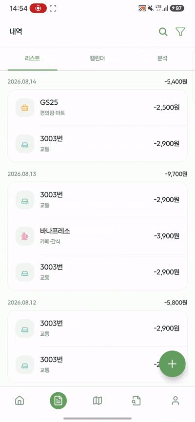 | 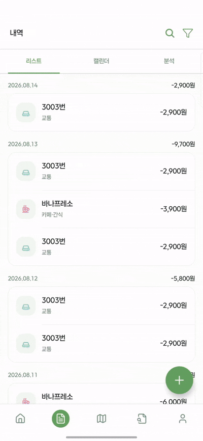 | 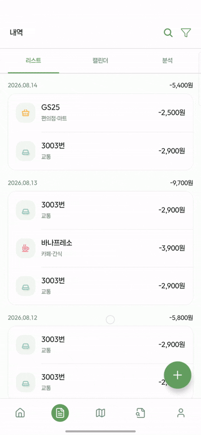 | 

- 수입·지출 내역 등록, 조회, 검색, 수정, 삭제
- 날짜, 금액, 카테고리, 결제 수단, 장소와 좌표 관리
- 최신순·오래된순 정렬 및 기간·카테고리 조건 검색
- 소득과 지출의 도메인 규칙을 분리해 일관된 데이터 유지

### 02. 소비 지도
| 줌 레벨 소비 시각화 | 내 장소 소비 시각화 |
| --- | --- |
| 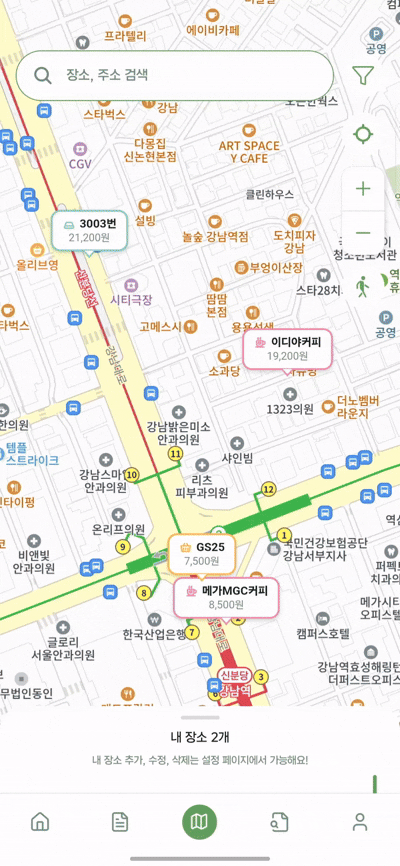 | 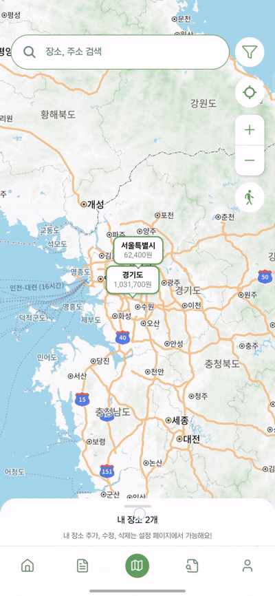 |

- 거래 좌표를 지도 마커로 시각화
- 줌 단계에 따라 **개별 장소 → 읍·면·동 → 시·군·구 → 시·도** 단위로 집계
- 같은 장소에서 발생한 여러 거래를 하나의 장소로 묶어 누적 소비를 표시
- 내 장소를 중심으로 반경 내 거래 내역 조회
- Kakao Maps JavaScript SDK를 React Native WebView에서 실행

### 03. 소비 캘린더와 분석
| 소비 캘린더 | 카테고리 분석 | 장소 분석 |
| --- | --- | --- |
| 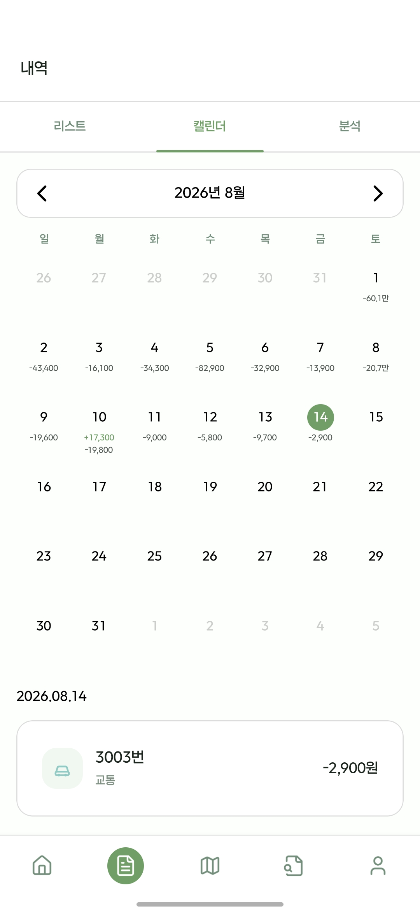 | 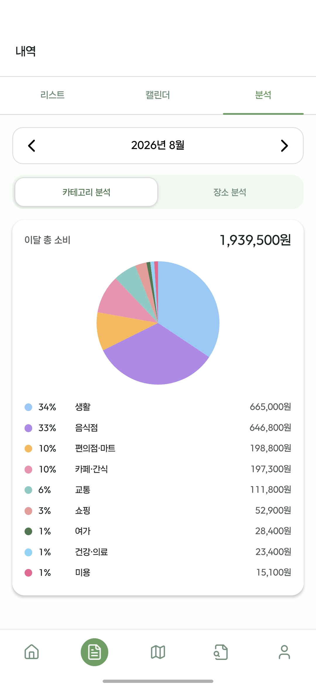 | 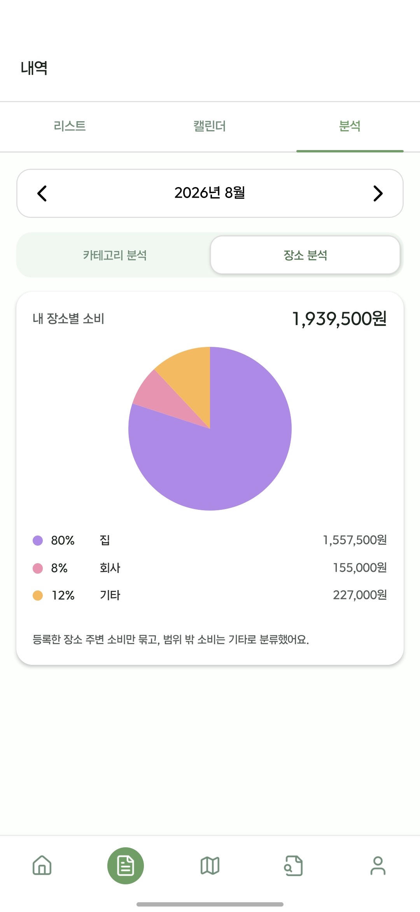 | 

- 월별 달력에서 날짜별 수입·지출과 순합계 확인
- 카테고리별 지출 비중 분석
- 사용자가 등록한 장소별 소비 분석

### 04. 위치 기반 절약 알림
| 방앗간 등록 | 방앗간 알림 |
| --- | --- |
|  | 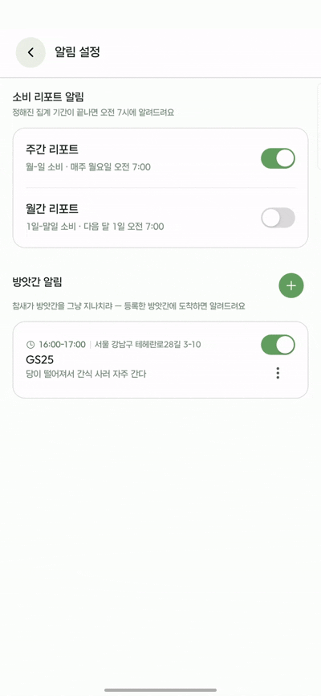 |

- 알림 장소, 시간대와 메시지 설정
- 앱이 백그라운드 상태일 때도 위치 진입 조건 확인
- 설정 시간대 내 동일 장소 재진입 시 중복 알림 방지

### 05. AI 주간·월간 소비 리포트

- 주간·월간 소비 데이터를 기반으로 핵심 소비 사실 추출
- 서버에서 검증한 소비 통계를 기반으로 AI 리포트 생성
- 총지출, 최대 지출 장소, 최다 방문 장소 등 핵심 소비 패턴 제공
- 반복 방문 장소를 분석해 다음 절약 알림 후보 추천
- 추천 장소를 위치 기반 절약 알림으로 연결
- FCM으로 새로운 리포트 도착 알림 전송

<!--
기능 이미지 삽입 위치

- 권장 파일: docs/images/readme/feature-ai-report.gif
- 권장 내용: 리포트 알림 → 요약 확인 → 추천 장소 알림 저장
-->

### 06. 인증 및 사용자 설정

- Google OIDC 기반 소셜 로그인
- Access Token·Refresh Token 기반 인증과 토큰 재발급
- Secure Store를 활용한 모바일 토큰 보관
- 닉네임, 알림 설정, 내 장소 관리

<a id="architecture"></a>

## 🏗️ 시스템 아키텍처

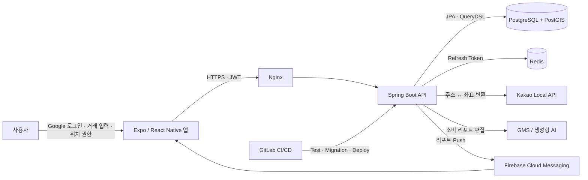

<!--
디자인한 아키텍처 이미지로 교체할 경우

- 권장 파일: docs/images/readme/system-architecture.png
- 포함 요소: Mobile, Nginx, Spring Boot, PostgreSQL/PostGIS, Redis, Kakao API, GMS, FCM, GitLab CI/CD
-->

### 서비스 간 통신

1. 모바일 앱이 Google ID Token으로 로그인하고 백엔드에서 JWT를 발급받습니다.
2. 앱은 JWT와 함께 `/api/v1/**` API를 호출합니다.
3. 백엔드는 PostgreSQL·PostGIS에서 사용자·거래·좌표 데이터를 관리합니다.
4. Redis는 Refresh Token 저장소로 사용됩니다.
5. Kakao Local API가 주소와 좌표에서 법정동 변환을 지원합니다.
6. 배치 작업이 소비 사실을 추출하고 생성형 AI가 리포트 문장을 편집합니다.
7. 완성된 리포트는 데이터베이스에 저장되며 FCM으로 도착을 알립니다.

### 배포 구조

- Nginx가 HTTPS 요청을 수신하고 로컬 `8080` 포트의 백엔드로 전달합니다.
- 백엔드, PostgreSQL·PostGIS, Redis는 Docker Compose 네트워크에서 통신합니다.
- 운영 데이터베이스와 Redis 포트는 외부에 직접 공개하지 않습니다.
- GitLab CI/CD가 백엔드 테스트, SQL 마이그레이션, 운영 배포를 수행합니다.

## 🔧 핵심 기술

### 01. PostGIS 기반 공간 소비 분석

거래와 내 장소의 좌표를 공간 데이터로 저장하고 거리·반경 조건을 데이터베이스에서 처리합니다. 지도 확대 수준에 따라 법정동 집계와 개별 장소 조회를 나누며, 동일 좌표의 거래는 하나의 마커로 묶습니다.

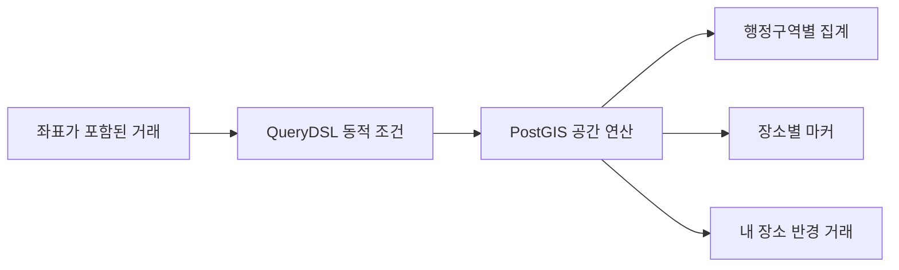

### 02. 사실 기반 AI 소비 리포트

생성형 AI가 금액을 직접 계산하게 두지 않습니다. 서버가 먼저 소비 통계와 핵심 사실을 결정하고, AI는 이 사실을 읽기 쉬운 문장으로 편집합니다.


- 수치·금액·장소는 서버에서 확정한 값만 AI에 전달합니다.
- AI 응답을 `headline`과 `body` 구조의 JSON으로 제한합니다.
- 근거 없는 과거 비교, 새로운 수치 생성, 과장된 조언을 금지합니다.
- 주간 리포트는 매주 월요일, 월간 리포트는 매월 1일 자동 생성합니다.

### 03. 행동으로 이어지는 장소 추천

리포트에서 끝나지 않고 반복 방문 장소를 위치 알림 후보로 연결합니다. 최근 추천 이력에 쿨다운을 적용해 같은 장소가 반복적으로 추천되는 것을 줄이고 추천 장소·시간대·이유를 알림 저장 화면의 초기값으로 전달합니다.

### 04. 모바일 위치 작업과 알림

Expo Location과 Task Manager를 이용해 백그라운드 상태일 때도 사용자의 위치를 확인합니다. 위치 반경·시간대가 모두 일치할 때 로컬 알림을 만들며, 서버가 생성한 리포트는 FCM으로 전달합니다.

### 05. 안전한 인증 흐름

Google ID Token의 Audience를 백엔드에서 검증한 뒤 자체 Access Token과 Refresh Token을 발급합니다. Refresh Token은 Redis에서 관리하고 앱의 토큰은 Expo Secure Store에 보관합니다.

## 🛠️ 기술 스택

| 영역 | 기술 |
| --- | --- |
| **Mobile** | React Native 0.86, React 19, TypeScript 6, Expo 57, Expo Router |
| **Client State** | TanStack Query, Zustand, AsyncStorage, Secure Store |
| **Map & Location** | Kakao Map, Kakao Local API, Expo Location, Expo Task Manager |
| **Notification** | Expo Notifications, Firebase Cloud Messaging |
| **Backend** | Java 21, Spring Boot 4.1, Spring MVC, Spring Security |
| **Data Access** | Spring Data JPA, QueryDSL, Hibernate Spatial, JTS |
| **Database** | PostgreSQL 16, PostGIS 3.5, Redis 7.4 |
| **AI** | GMS OpenAI-compatible API (`gpt-5.4-mini` 기본값) |
| **API Docs** | springdoc-openapi, Swagger UI |
| **Infra** | Docker, Docker Compose, Nginx, GitLab CI/CD |
| **Test** | JUnit 5, MockMvc, Testcontainers |

### 기술 선택 이유

#### Expo · React Native

- 하나의 TypeScript 코드베이스에서 Android 앱과 웹 개발 환경을 함께 운영할 수 있습니다.
- 위치, 백그라운드 작업, 로컬·푸시 알림을 Expo API로 연결합니다.
- Expo Router의 파일 기반 라우팅으로 화면 구조를 명확하게 유지합니다.

#### Spring Boot · Java 21

- 인증, 검증, 스케줄링, 데이터 접근 계층을 안정적으로 구성합니다.
- Spring Security Resource Server로 JWT 인증과 역할별 인가를 적용합니다.
- Springdoc으로 구현된 API를 Swagger 문서로 제공합니다.

#### PostgreSQL · PostGIS

- 일반 거래 데이터와 공간 데이터를 하나의 트랜잭션 안에서 관리합니다.
- 장소 반경 조회와 지역별 집계를 별도 공간 데이터베이스 없이 구현합니다.
- QueryDSL로 기간, 카테고리, 정렬, 공간 조건을 동적으로 조합합니다.

#### Redis

- Refresh Token을 애플리케이션 데이터와 분리해 관리합니다.
- 토큰 재발급과 로그아웃 시나리오를 빠르게 처리합니다.

<a id="erd"></a>

## 🗂️ ERD

<!--
ERD 이미지 삽입 위치

- 권장 파일: docs/images/readme/erd.png
- 권장 내보내기: 배경 흰색, 가로 2000px 이상의 PNG 또는 SVG
<p align="center"></p>
-->

주요 테이블은 다음과 같습니다.

- `users`
- `category`
- `transaction_history`
- `my_place`
- `notification_place`
- `report`
- `notification_place_recommendation_log`
- `user_push_tokens`
- `refresh_tokens`

> 실제 스키마는 `backend/db/migration/001__initial_schema.sql`에서 확인할 수 있습니다.
> 

## 📂 디렉터리 구조

```
S15P11A508/
├── ai/                         # AI 리포트 실험 및 검증
├── backend/
│   ├── db/migration/           # 운영 SQL 마이그레이션
│   └── src/                    # Spring Boot 소스와 테스트
├── frontend/
│   ├── app/                    # Expo Router 라우트
│   ├── assets/                 # 이미지·아이콘·폰트
│   ├── components/             # UI 컴포넌트
│   ├── hooks/                  # Query 및 앱 동작 Hook
│   ├── src/api/                # Backend API Client
│   ├── src/screens/            # 주요 화면
│   ├── store/                  # Zustand Store
│   └── utils/                  # 위치·알림·리포트 Utility
├── infra/                      # 운영 Compose와 Nginx
├── scripts/                    # 배포·마이그레이션 Script
├── docs/                       # 운영 및 프로젝트 문서
└── .gitlab-ci.yml              # CI/CD Pipeline
```

## 🚀 로컬 실행

사전 준비: Docker, JDK 21, Node.js 20+, Android 기기 또는 에뮬레이터

```bash
# 1. 환경변수 준비 (.env.example 참고, 값 채우기)
cp .env.example .env

# 2. PostGIS · Redis 실행
docker compose -f docker-compose.local.yml up -d

# 3. 백엔드 실행 (.env 값을 환경변수로 로드한 상태에서)
cd backend && ./gradlew bootRun

# 4. 모바일 앱 실행
cd frontend && npm install && npx expo start
```

- Swagger UI: `http://localhost:8080/swagger-ui/index.html`
- 시연용 시드 데이터: `scripts/seed.sql`, `scripts/seed_report.sql`

## 📦 배포 · 운영 문서

| 문서 | 내용 |
| --- | --- |
| [환경변수 관리 정책](docs/deployment/environment-variables.md) | 변수 명세, 로컬·운영 값, Secret 관리 기준 |
| [운영 DB Migration](docs/deployment/database-migrations.md) | 마이그레이션 파일 규칙과 CI 자동 적용 절차 |
| [CI/CD 파이프라인](.gitlab-ci.yml) | test → verify-deploy → migrate → deploy |
| [운영 Compose](infra/compose.prod.yml) · [Nginx](infra/nginx/akkiljido.conf) | 운영 컨테이너 구성과 Reverse Proxy 설정 |

## 👥 팀

| 이름 | 역할 | 담당 기능 | 링크 |
| --- | --- | --- | --- |
| 정보경 | 백엔드, 팀장 | 거래내역 CRUD, 홈 화면 API | https://github.com/jungbk0808 |
| 천명석 | 백엔드 | 로그인, 알림 기능, 마이페이지 CRUD | https://github.com/myeongseok12 |
| 류남경 | 프론트엔드 | 지도, 리포트, 설정 페이지 | https://github.com/rnk00 |
| 정인경 | 프론트엔드 | 홈, 거래내역 페이지 및 알림 | https://github.com/cik0126-design |
| 정재영 | 인프라 | EC2 기반 Docker 인프라 구축 및 CI/CD 배포 자동화 구성 | https://github.com/jeayoung98 |
| 박준우 | AI | AI 레포트 및 알림 추천 기능 구현 | https://github.com/busypark |

## 📄 라이선스

<!-- TODO: 실제 라이선스를 결정한 뒤 LICENSE 파일과 아래 문구를 수정하세요. -->

```
Copyright © 2026 아낄지도 팀. All rights reserved.

본 프로젝트는 SSAFY 교육 과정에서 제작된 팀 프로젝트입니다.
별도의 허가 없이 소스 코드를 복제, 수정, 배포 또는 상업적으로 이용할 수 없습니다.
```